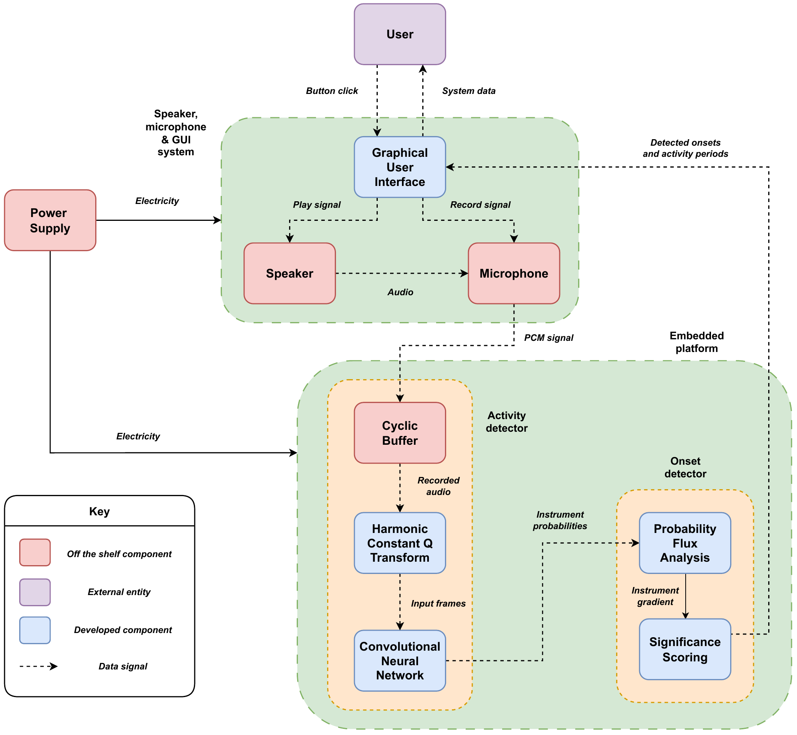
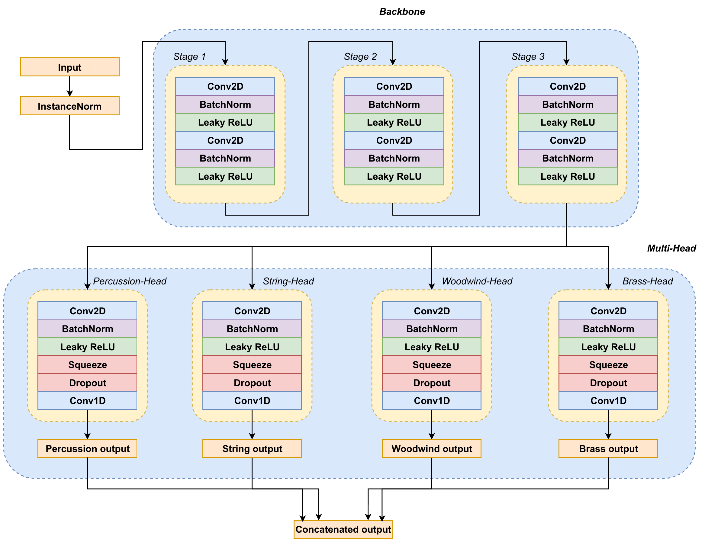
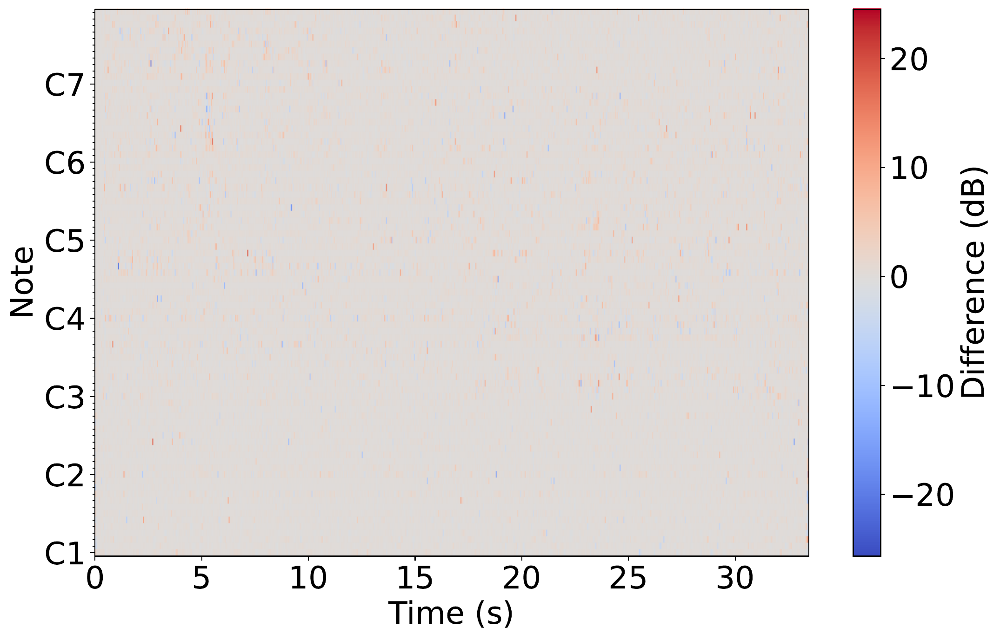

# Instrument Detection in Polyphonic Recordings

An embedded system that listens to a live classical chamber-music performance (duets through
quintets) and detects, in real time, which of 11 instruments are playing and when each one enters
the mix. Built as my final-year Computer Engineering capstone project (University of Pretoria,
EPR402, 2025).

Everything in this repository is implemented from first principles: the audio feature extraction,
the CNN, the training loop, the optimiser, the loss function and the onset-detection logic. The neural network is trained in PyTorch, but the
inference engine that runs on the target hardware is a hand-written C implementation that
re-derives the forward pass, convolution and Constant-Q Transform from scratch.

**Full write-up:** [`docs/22659511_ChunderH_FINALREPORT.pdf`](docs/22659511_ChunderH_FINALREPORT.pdf).
It covers the literature review, the architecture trade-off analysis, the verification
methodology and the full set of results. This README is a shorter version aimed at a code
reviewer.

## What it does

Given a polyphonic audio stream (live microphone input or a `.wav` file), the system reports, for
each of piano, violin, viola, cello, contrabass, clarinet, bassoon, oboe, flute, French horn and
trumpet, whether it is present, its per-frame confidence over time, and the timestamp of its first
onset in the mix.

| Metric (100 ms onset tolerance) | Target | Achieved | Target met? |
|---|---|---|---|
| Macro F1 | ≥ 0.75 | **0.743** | No, short by 0.007 |
| Macro precision | ≥ 0.77 | **0.741** | No, short by 0.029 |
| Macro recall | ≥ 0.73 | **0.768** | Yes, above by 0.038 |
| Real-time processing factor (Jetson Nano) | ≤ 2.0x clip duration | **1.81x** average (1.76x to 1.83x) | Yes |

The macro figures are the mean of the 11 per-instrument scores, each computed from the true
positives, false positives and false negatives pooled over all the test recordings (report §4.2).

The dominant failure mode is false positives rather than missed detections. This is traced back to
heavy instrument co-occurrence in the training data (for example, viola co-occurs with
violin/cello 78-86% of the time in the compiled dataset). See §4.2/§5 of the report for the full
discussion.

## How it works



**Feature representation.** The HCQT stacks 5 CQTs at `f_min, 2f_min, 3f_min, 4f_min, 5f_min`
(`f_min` = C1, 32.7 Hz), so that each frequency bin's harmonic series lines up across channels.
This makes it much easier for the CNN's early layers to learn timbral features than a plain
spectrogram would. On the training side this is `librosa.cqt` (`python/instrument_detection/data/hcqt.py`); the deployed
version is a from-scratch, FFTW-based implementation (`c/src/cqt.c`). Report §3.5 covers why HCQT
was chosen over Mel-spectrograms and MFCCs for this task.

**Model.** A multi-head VGG-style CNN (`VGGMultiHead` in `python/instrument_detection/models/model.py`). A shared 6-layer
convolutional backbone downsamples along the frequency axis only, so time resolution is preserved
throughout, followed by four independent classification heads, one per instrument family (piano,
strings, woodwinds, brass) rather than one shared 11-way head.



Report §3.6 documents the architecture search (VGG vs. ResNet) that led here. Class imbalance
(violin and piano appear roughly 15x more often than contrabass and trumpet in the compiled
dataset) is handled through `BCEWithLogitsLoss` positive class weighting and per-instrument
F1-optimal decision thresholds, rather than by discarding data.

**Onset detection.** Fully rule-based, running on the CNN's output probability timeline with no
further learning involved. An instrument is flagged as "active" once its probability crosses a
tuned threshold for long enough (`python/instrument_detection/onset/activity_period.py`), and an "onset" is confirmed where
an activity period overlaps a sharp rise in probability, referred to as "flux"
(`python/instrument_detection/onset/activity_gradient.py`). Per-instrument thresholds and flux/activity parameters were tuned
by exhaustive grid search against a held-out validation set (`python/instrument_detection/onset/onset_param_tune.py`).

**Deployment.** The trained PyTorch model's weights are exported and BatchNorm-folded: every
`Conv2d -> BatchNorm2d` pair is algebraically fused into a single convolution, so the C engine only
ever needs to run a plain conv+bias (see `docs/22659511_ChunderH_FINALREPORT.pdf` §3.6.5 for the
derivation and a layer-by-layer numerical verification against PyTorch, where the largest
absolute error in any layer is about 9e-6). The result is exported into flat binary files consumed by
`c/src/weight_loader.c`. This repository ships the code, not the trained weights or the dataset -
`python/instrument_detection/export/` holds the scripts that regenerate the weights from a trained
checkpoint, and `c/README.md` explains the steps. The C inference engine (`c/`) loads them
directly, with no ONNX runtime, TensorRT or libtorch involved, and runs the full HCQT -> CNN ->
onset pipeline on a Jetson Nano's ARM Cortex-A57 CPU. It uses OpenMP for layer-level parallelism,
ARM NEON SIMD intrinsics in the inner convolution loop, and cache-aware loop tiling (8x16 tiles
sized to fit the Nano's L1/L2 cache).

## Repository structure

```
InstrumentDetectionPolyphonicRecordings/
├── python/                     Training pipeline and the Python-side onset detection.
│   └── instrument_detection/   One importable package, split by stage:
│       ├── models/             CNN architectures and the registry of compared models.
│       ├── data/               HCQT feature extraction, dataset building, augmentation.
│       ├── training/           Training loop, HPO, early stopping, and the from-scratch loss
│       │                       and AdamW optimiser (both verified against PyTorch).
│       ├── export/             Scripts that fold a trained model into the binary weights and the
│       │                       model_params.h header used by the C engine.
│       ├── activity/           Frame-level instrument activity inference and its evaluation.
│       ├── onset/              Rule-based onset detection, evaluation and parameter tuning.
│       └── recording/          Speaker-to-mic re-recording and alignment tools.
│       See python/README.md for a file-by-file breakdown and how to run each script.
├── c/                          Deployed inference engine that runs on the Jetson Nano.
│   ├── src/                    Core library: HCQT, convolution kernels, weight loading,
│   │                           onset detection, audio capture.
│   ├── app/                    The on-device program (main_inference.c).
│   ├── verification/           Host-side tools that check the C code against Python.
│   ├── include/                Headers (model_params.h is generated).
│   └── third_party/            dr_wav.h, a third-party single-header WAV library.
│   See c/README.md for a file-by-file breakdown.
└── docs/                       Full final report plus the figures embedded in this README.
                                See docs/README.md.
```

Each subfolder has its own `README.md` with a short summary of every file in it. Start there if
you want to jump straight to a specific piece, such as the CQT implementation, the onset detector,
or the from-scratch optimiser.

## Verification methodology

Every from-scratch component was checked against a reference implementation before being trusted.
For the CQT, the custom FFTW-based C implementation was compared bin-by-bin against `librosa.cqt`
on the same audio. The difference is essentially at the noise floor, with no structural pattern:



- **Forward pass:** the full folded C model against the live PyTorch model, layer by layer, on
  identical input (report Table 10). The mean absolute error is between 4e-8 and 2.8e-6 per layer
  and the largest single-element error is 9.1e-6, which is consistent with single-precision
  floating point rounding rather than a genuine mismatch.
- **Loss function:** the from-scratch, numerically-stable BCE-with-logits implementation against
  `torch.nn.BCEWithLogitsLoss` on a fixed test vector. Outputs match to 8 decimal places.
- **Optimiser:** the from-scratch AdamW update rule was run next to `torch.optim.AdamW` on the
  3D Rosenbrock function (start at [-1, 2, -0.5], learning rate 0.01, weight decay 0.01, 1000
  steps). The two parameter trajectories overlap and the maximum relative error in the loss is
  about 6.9e-16. Run it with `python/instrument_detection/training/adamw_optimiser_test.py`.

## Running it

The dataset and the trained weights are not part of this repository, so these steps assume you
have your own copies. Full details are in `python/README.md` and `c/README.md`.

**Python (training, evaluation, onset detection).** Install the dependencies (torch, torchaudio,
librosa, numpy, scipy, pandas, h5py, optuna, scikit-learn, scikit-multilearn, soundfile,
sounddevice, matplotlib, tqdm), put the dataset in `python/Dataset/` with the layout set in
`python/instrument_detection/config.py`, then run everything from `python/`:

```
cd python
python -m instrument_detection.training.train_instrument_model
python -m instrument_detection.onset.onset_eval
```

**C engine (Jetson Nano or any Linux machine with the libraries below).** Needs `gcc`, FFTW3
(single precision, `libfftw3f`), ALSA (`libasound`) and OpenMP. The NEON code path needs an ARM CPU.

```
cd python
python -m instrument_detection.export.export_model_architecture   # writes c/include/model_params.h
python -m instrument_detection.export.export_folded_weights       # writes c/assets/c_weights/
cd ../c
make
./bin/instrument_detector            # analyses the wav file set by INPUT_WAV_FILE in app/main_inference.c
./bin/instrument_detector record     # records from the microphone instead
```

## Known limitations

- Performance is bottlenecked by false positives from instrument co-occurrence bias in the
  training data, particularly within the string and woodwind families, rather than by an inability
  to detect onsets. See the report's discussion (§5/§6.2) for the full analysis and suggested
  fixes.
- There is still a measurable domain gap between the training data, even after re-recording
  through a real speaker/mic chain, and arbitrary real-world recording conditions. Report §3.10.2
  quantifies this using Pearson correlation and cosine similarity of HCQTs across recording
  domains.
- This repository is a cleaned-up snapshot of a research/capstone codebase, not a maintained
  library. See `docs/` for the full list of design trade-offs and suggested future work.

## Acknowledgements

Supervised by Prof. J.P. Jacobs, Department of Electrical, Electronic and Computer Engineering,
University of Pretoria. WAV file I/O in the C engine uses the single-header
[`dr_wav`](https://github.com/mackron/dr_libs) library by David Reid.
